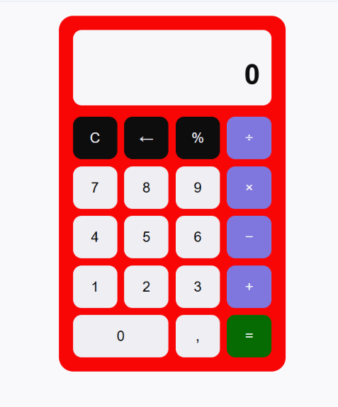

# Calculadora



Calculadora web feita com HTML, CSS e JavaScript, sem bibliotecas.

Foi meu primeiro projeto depois de decidir mudar de área. Comecei pensando que seria rápido, mas a maior parte do tempo foi gasta em coisas que eu nem imaginava: o número comprido que vazava do visor,
a calculadora que saía do lugar quando eu clicava, o resultado que não limpava na hora certa. Cada um desses virou uma coisa nova que eu aprendi.

[Acessar a calculadora](https://github.com/HellenMayara/calculadora)

## Funcionalidades

- Soma, subtração, multiplicação e divisão
- Porcentagem
- Apagar o último dígito ou limpar tudo
- Números decimais com vírgula
- Separador de milhar (ex: 2000 aparece como 2.000)
- Visor que diminui a fonte conforme o número cresce
- Limite de 12 dígitos por número
- Tratamento de divisão por zero
- Operações encadeadas (5 + 3 + 2 sem apertar igual no meio)
- Uso pelo teclado do computador, com destaque na tecla pressionada (o número digitado no teclado pisca na tela)
- Layout responsivo

## Tecnologias

- HTML5
- CSS3
- JavaScript

## Como executar

```bash
git clone https://github.com/HellenMayara/calculadora.git
```
Não é necessário instalar nada.

## Desafios enfrentados

**O número vazando do visor** →
Sempre que eu digitava um número muito grande, ele vazava do visor da calculadora. Coloquei um limite de 12 dígitos no JavaScript e usei `overflow: hidden` com `text-overflow: ellipsis` no CSS,
para o que passasse do espaço aparecer com reticências.

**A calculadora escorregava** →
A cada clique nas teclas da calculadora ela escorregava para o lado esquerdo da tela. Esse foi o que mais me deu trabalho, porque eu estava procurando no lugar errado, primeiro achei que era por causa dos números vazando
do visor e tentei resolver com `overflow: hidden`, não deu certo. Tentei `min-width: 0` nos elementos e também não mudou nada. Só resolveu quando parei de centralizar com Flexbox no body e passei a usar `margin: 0 auto`.
Perdi a centralização vertical nessa troca, mas pelo menos a calculadora parou de escorregar.

**Sem reset no visor** →
O visor não resetava após os resultados dos cálculos. Se eu fizesse 5 + 3 = e depois do resultado que era 8 digitasse 7, aparecia no visor 87, porque o código não sabia diferenciar um resultado de um número que eu tinha digitado.
Criei uma variável `acabouDeCalcular` para guardar essa informação, e agora o visor limpa antes de receber o novo número. 

**A fonte no visor não diminuia** →
Depois de limitar a quantidade de dígitos, quis que o número fosse ficando menor conforme o visor enchesse, em vez de só cortar.
Usei `clamp` no CSS e achei que tinha resolvido, mas ao testar o número continuava do mesmo tamanho. Percebi que o `clamp` ajusta a fonte conforme a largura da tela, e a minha janela não muda de tamanho enquanto eu digito.
Quem sabia quantos dígitos tinham era o JavaScript, então passei o controle pra lá.
Agora a função que atualiza no visor conta os caracteres e define o tamanho da fonte em faixas.

**Separar o milhar** →
Quis que números de valores altos ficassem mais fáceis de ler, com 2000 aparecendo como 2.000. 
Pensei em colocar o ponto direto na variável, mas percebi que isso quebraria o cálculo, porque o `parseFloat` não entende o ponto de milhar do jeito que a gente usa. 
Então criei uma função que só formata na hora de mostrar na tela, a variável continua guardando 2000 sem o ponto, e o visor exibe 2.000.
Foi aqui que entendi a diferença entre o dado que o programa guarda e a forma como ele aparece para quem usa.

## Melhoria futura

- Histórico de operações

## Autoria

Feito por [Hellen Mayara](https://github.com/HellenMayara)


